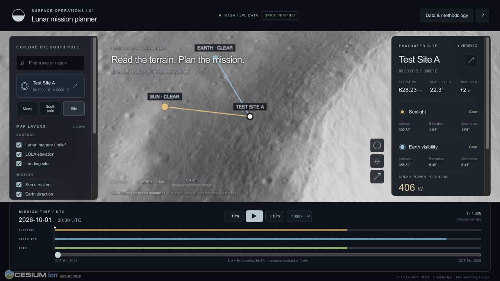
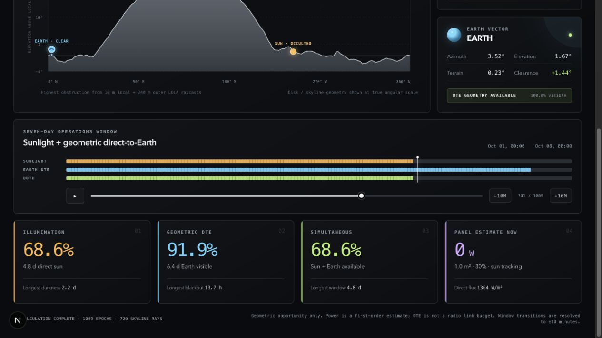
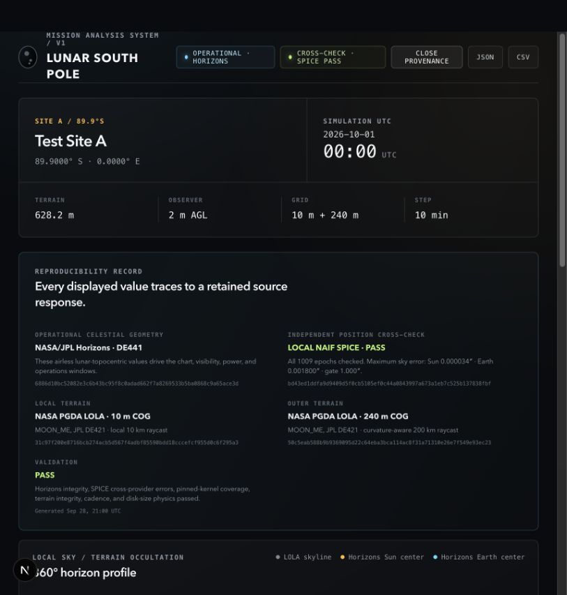

# Lunar South Pole Mission Planner

A scientifically traceable V1 for one real lunar surface location. It combines
NASA/JPL Horizons operational celestial geometry, an independent local
NASA/JPL NAIF SPICE implementation cross-check, and NASA GSFC PGDA/LOLA terrain
to answer, over a configurable time range:

- where the Sun and Earth appear in the local lunar sky;
- whether the real terrain skyline fully or partially blocks either disk;
- continuous direct-sunlight and geometric direct-to-Earth (DTE) windows;
- simultaneous sunlight + DTE availability; and
- first-order direct solar input for configurable panel geometry.

The default reproducible run is Test Site A at `-89.9°`, `0° E`, with a 2 m
observer, from `2026-10-01T00:00:00Z` through `2026-10-08T00:00:00Z` at a
10-minute cadence. The pipeline never substitutes synthetic science data when
NASA/JPL sources fail.



The interactive Cesium first draft adds a lunar globe, streamed terrain, NASA slope
and PSR overlays, point inspection, and time-synchronized mission geometry.
See [visual draft implementation and verification](docs/VISUAL_DRAFT.md).

## Verified default result

The completed run contains 1,009 inclusive epochs and 720 horizon azimuth rays.
Every epoch is independently recomputed with the pinned local SPICE kernel set.
Maximum local-sky vector separation is **0.000033717 arcsec for the Sun** and
**0.001800102 arcsec for Earth**, both far inside the 1 arcsec release gate.
At the first epoch:

| Quantity | Sun | Earth |
|---|---:|---:|
| Apparent azimuth | 302.828959535° | 358.807428905° |
| Apparent elevation | 1.037972508° | 6.492099500° |
| Terrain horizon | -0.902556405° | 0.081940887° |
| Center clearance | +1.940528913° | +6.410158613° |
| Visible fraction | 100% | 100% |

Site elevation from the 10 m LOLA crop is 628.229797 m above the 1,737.4 km
reference sphere. The 2 m AGL observer is therefore sent to Horizons at
0.630229797 km above that same sphere.

Seven-day grid-resolved results:

- any direct sunlight: **68.5516%** / **115.1667 h**;
- geometric DTE: **91.8651%** / **154.3333 h**;
- both simultaneously: **68.5516%** / **115.1667 h**;
- longest terrain-shadow period: **52.8333 h**;
- longest DTE terrain blackout: **13.6667 h**.

Transitions use left-closed 10-minute sample intervals and therefore carry a
10-minute time-grid bound. This is geometric opportunity analysis, not a radio
link budget or a flight-qualified power analysis.

## Run the science pipeline

Python 3.10+ and `uv` are recommended:

```bash
uv venv
uv pip install -e '.[dev]'

.venv/bin/python run_simulation.py \
  --lat -89.9 \
  --lon 0 \
  --observer-height-m 2 \
  --start 2026-10-01T00:00:00Z \
  --end 2026-10-08T00:00:00Z \
  --step-minutes 10
```

The first run reads only two server-side COG windows, then caches their local
lossless crops, checksums, horizon profiles, raw Horizons responses, and exact
request parameters. It also downloads the five locked NAIF kernels into
`data/kernels`, rejects any byte-size or SHA-256 mismatch, verifies SPK/PCK time
coverage, and computes the SPICE comparison locally. Repeat runs are
offline-reproducible from those caches.

The locked kernel set can be fetched or verified separately:

```bash
.venv/bin/python -m science.ephemeris.kernels data/kernels
.venv/bin/python -m science.ephemeris.kernels data/kernels --verify-only
```

Observer heights of 0, 2, 5, or 10 m—and other non-negative values—are supported
through `--observer-height-m`. Panel modes are `sun_tracking`,
`horizontal_fixed`, and `custom_normal` (`--panel-normal-enu E N U`).

Outputs:

- `outputs/simulation.json`: full provenance, assumptions, skyline, samples,
  windows, and validation record;
- `outputs/simulation.csv`: flat per-epoch operations table;
- `apps/web/public/data/`: copies consumed by the local UI.

## Run the web application

```bash
cd apps/web
npm install
npm run terrain:prepare
npm run planner
```

Open [http://127.0.0.1:3000](http://127.0.0.1:3000). The first 3D draft opens a
Cesium Moon, streams real LOLA relief, flies to Test Site A, and connects its
Sun/Earth direction markers to the unchanged validated simulation. NASA slope,
PSR and uncertainty overlays are available around the site. Click terrain for
source values, scrub time, or open the horizon and methodology panels.

`npm run planner` starts Next.js and the local read-only terrain service on
127.0.0.1:8766. For production, run `npm run build` followed by
`npm run planner -- --production`. No Cesium ion token is needed.

To leave the production preview running after closing the launching terminal:

```bash
npm run planner:background
npm run planner:status
# When finished:
npm run planner:stop
```

The background command waits until both the page and terrain proxy respond.
Its log and PID are under the ignored `apps/web/.runtime/` directory. It stays
running until stopped or the Mac session ends; rerun the command after a restart.
See [3D draft architecture and limitations](docs/VISUAL_DRAFT.md).





## Test and verify

```bash
python3 -m unittest discover -s tests -v
cd apps/web
npm run lint
npm run build
```

The verification suite includes provider, frame, coverage, corrupt-kernel,
secure-download, all-epoch comparison, terrain, visibility, power, export, and
window tests, plus ESLint, a Next.js production build, and an interactive
browser check. Details are in [docs/VALIDATION.md](docs/VALIDATION.md).

## Architecture

```text
NASA PGDA 10 m COG ── crop 10 km ── spherical raycast ─┐
                                                       ├─ maximum skyline
NASA PGDA 240 m COG ─ crop 200 km ─ spherical raycast ─┘
                                                               │
NASA/JPL Horizons (Sun + Earth lunar topocenter) ───────────────┤
                                                               ▼
extended-disk occultation → panel model → window extraction
                                │
                                ├─ JSON / CSV
                                └─ Next.js interactive dashboard

Pinned NAIF DE440s + lunar PCK/FK ─ local SPICE az/el/range ─┐
NASA/JPL Horizons DE441 observer rows ────────────────────────┴─ all-epoch error gate
```

The ephemeris layer implements two `EphemerisProvider` backends. Horizons is the
operational source driving the displayed simulation. SPICE is deliberately kept
validation-only: its values are never substituted, blended, or averaged into
the terrain visibility, power, or window outputs.

For equations, frame conventions, exact datasets, assumptions, and known
limits, see [docs/SCIENTIFIC_METHOD.md](docs/SCIENTIFIC_METHOD.md).
