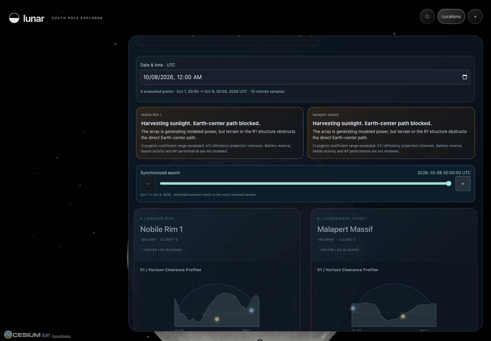

# Lunar South Pole Explorer

Explore the Moon, compare evaluated south-pole points, and visualize how sunlight and Earth visibility change over time.

**Research and education—not flight certification.** Geometric visibility is not RF link quality. Modeled generation is not guaranteed power or battery charge.



## Features and coverage

- Interactive Cesium Moon, terrain inspection and apparent Sun/Earth sky view.
- Five evaluated points: Connecting Ridge, Haworth, Malapert Massif, Nobile Rim 1, and the neutral **Test Site A** validation coordinate—not five certified landing sites.
- **October 1, 00:00 → October 8, 00:00, 2026 UTC**, with 1,009 ten-minute epochs per point. Unsupported dates remain unavailable.
- Synchronized dual-site comparison, modeled generation, Earth-center visibility, disk exposure and thermal-model limitations.
- Reference lander R1: five attitudes and two assumed thermal environments—not exact flight hardware.
- SPICE-driven orbital view with 4K Earth/Sun textures. Displayed sizes and distances are compressed, not to scale.
- Checksummed exports and prepared terrain grids for running the included snapshot without regenerating the science.

## Quick start

Prerequisites: Python 3.12+, Node.js 22.6+ (Node 24 LTS recommended), npm and Git. No Cesium ion token is required.

```sh
git clone https://github.com/Klauscreates/lunar-south-pole-explorer.git
cd lunar-south-pole-explorer
python3 -m venv .venv
.venv/bin/python -m pip install -e '.[dev]'
cd apps/web
npm ci
npm run build
npm run planner -- --production
```

Open **http://127.0.0.1:3000**. The launcher starts Next.js and the read-only Python terrain service together. Keep the terminal running; Ctrl+C stops both. Dependency installation needs internet access. Installation copies Cesium workers; the build verifies and copies the committed study exports.

For development, use `npm run planner` from `apps/web`. Do not run terrain preprocessing merely to view this snapshot: the required bounded grids and imagery are included. The verification commands below are run from the repository root.

### First visit

1. Open **Locations** and select a point.
2. Expand its name card and scrub the UTC timeline. Instantaneous values and whole-week totals are labeled separately.
3. Choose **Compare this location** and pick a second point.
4. Open **How to use · methods & data** for limits, or **＋** for detailed instruments.

## Repository map

| Folder | Contents |
| --- | --- |
| `apps/web/` | Next.js/React/Cesium interface and frontend tests |
| `science/` | Ephemerides, horizon, visibility, power, thermal and vehicle models |
| `scripts/` | Terrain service, asset preparation and orbital export |
| `data/` | Source catalogues, vehicle specifications and prepared runtime terrain |
| `outputs/` | Checksum-indexed precomputed study snapshots |
| `tests/` | Python scientific and integration tests |
| `docs/` | Methods, provenance, limits and acceptance evidence |

Raw download caches, environments, logs and unrelated media are excluded. Local paths retained in provenance describe the generating machine; they are not runtime requirements. Kernels are downloaded separately using `science/ephemeris/kernels.lock.json`.

## Verification

```sh
.venv/bin/python -m pytest -q
npm --prefix apps/web run lint
node --experimental-strip-types --test apps/web/scripts/*.test.mjs
npm --prefix apps/web run build
```

Browser acceptance: run `apps/web/scripts/acceptance.mjs` with `PLAYWRIGHT_MODULE` pointing to an installed Playwright ESM entry point. Chrome is the default browser; `APP_URL` selects the target server. See [acceptance evidence and limitations](docs/RELEASE_ACCEPTANCE.md). Raw-source regeneration and some audit checks require separately downloaded source material or kernels.

## Science and provenance

Operational site geometry uses JPL Horizons, cross-checked with local NAIF SPICE, and LRO LOLA terrain masks. Both geometry implementations share JPL ephemeris lineage. Registered NAC is a separately labeled experimental study; absent qualified coverage stays Unknown.

- [Scientific method](docs/SCIENTIFIC_METHOD.md) and [SPICE integrity](docs/SPICE_INTEGRITY.md)
- [Candidate coordinates](docs/CANDIDATE_ARRAY_2026-09-30.md)
- [Reference lander assumptions](docs/REFERENCE_LANDER.md)
- [Native terrain limitations](docs/NATIVE_TERRAIN.md)
- [Celestial imagery and attribution](docs/CELESTIAL_VISUALS.md)
- [Third-party notices](THIRD_PARTY_NOTICES.md)

Root `run_*.py` entry points regenerate their respective studies. Read the methods before running them: downloads can be substantial, and changed inputs require rebuilding dependent checksum indexes. The frontend rejects stale or altered exports.

## Hosting

Permanent cloud deployment is not yet complete. Both Next.js and the terrain backend must be hosted; a frontend-only upload is insufficient. Server-only `TERRAIN_SERVICE_URL` supports a separate backend. See [deployment requirements](docs/RELEASE_ACCEPTANCE.md). Temporary tunnel links are not permanent hosting.

## License

No open-source license has been assigned to original project code. Third-party software, imagery and documents retain their respective terms. Repository visibility does not change those rights.
